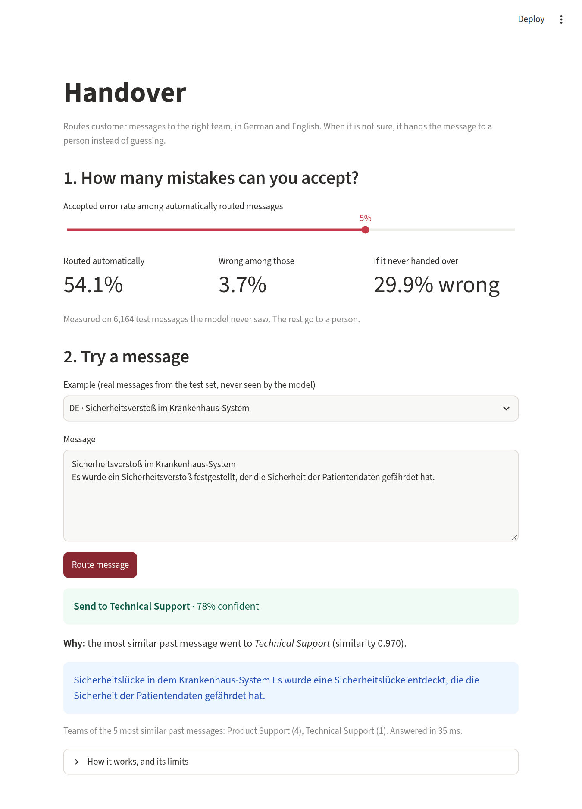
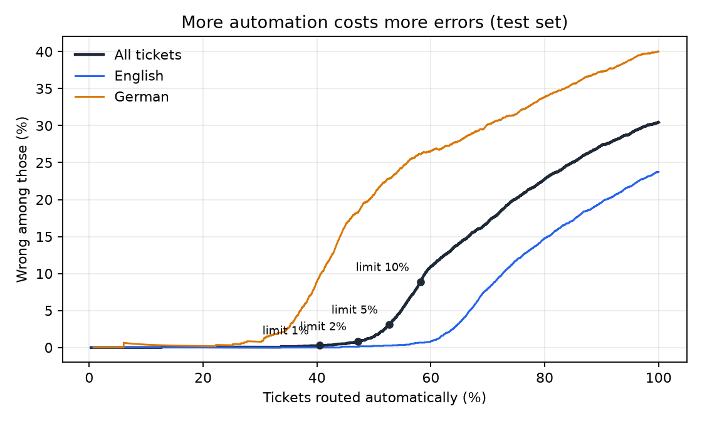
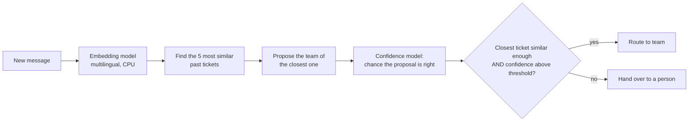

# Handover

**KI-Ticketrouting mit menschlicher Übergabe** · Ticket routing that knows when to ask a person

Handover routes customer messages to the right team, in German and English. When it is not sure, it hands the message to a person instead of guessing, and the share of wrong automatic decisions stays under a limit you choose.

**Live demo:** _link added after deployment_ · **Demo video:** _to be recorded_



## Results

Measured on 6,164 test tickets that were never used for building or tuning.

| Accepted error limit | Routed automatically | Wrong among those | Handed to a person |
|---|---|---|---|
| 1% | 41.4% | 0.2% | 58.6% |
| 2% | 49.1% | 1.0% | 50.9% |
| **5% (default)** | **54.1%** | **3.7%** | **45.9%** |
| 10% | 58.7% | 8.5% | 41.3% |
| No handover | 100% | 29.9% | 0% |

Every limit was kept on the test set. Without handover, three in ten tickets go to the wrong team; with a 5% limit, more than half of all tickets are routed automatically and fewer than one in twenty-five of those is wrong.



| Other measurements | Value |
|---|---|
| Accuracy if it always answers | 70.1% (English 76.3%, German 61.1%) |
| Always guessing the largest team | 29.3% |
| Calibration error of the confidence score (ECE) | 0.021 (raw similarity: 0.268) |
| Response time on a laptop CPU, median / 95th percentile | 157 ms / 225 ms |
| Running cost | 0 EUR (CPU only, free hosting tier) |

## How it works



1. **Memory.** 24,091 past tickets are stored as vectors from a small multilingual embedding model (`intfloat/multilingual-e5-small`).
2. **Proposal.** A new message gets the team of its most similar past ticket.
3. **Confidence.** A small logistic model estimates the chance that the proposal is right from three signals: similarity of the closest ticket, how many of the 5 neighbours agree, and how far the closest stands out from the rest.
4. **Novelty gate.** If the closest past ticket is below 0.964 similarity, the message is always handed over. Below that point the closest ticket is wrong more often than right.
5. **Threshold with a guarantee.** The confidence threshold is the lowest one for which a statistical upper bound on the error rate (95% confidence, Clopper–Pearson, fixed-sequence testing) stays under the chosen limit. It is chosen on data the model never saw.

Every decision comes with its reason: the past message it was matched to.

## The finding that shaped the design

The first version was a standard classifier on embeddings. It reached 40.3% accuracy and could automate only 6% of tickets at a 10% error limit. Checking why showed two things about the data:

| Closest past ticket | Share of test tickets | Proposal correct |
|---|---|---|
| Near copy (similarity ≥ 0.985) | 27.0% | 99.6% |
| Similar (0.97–0.985) | 23.8% | 90.0% |
| Loosely similar (0.95–0.97) | 30.4% | 48.9% |
| Nothing similar (< 0.95) | 18.9% | 36.7% |

About half the tickets closely resemble an earlier ticket and go to the same team. For the rest, the team is close to unpredictable from the text: on tickets with nothing similar in memory, a logistic regression on embeddings gets 39.6%, a word-count model 37.9%, and always guessing the largest team 29.7%.

So the system routes what resembles the past and hands over what is new. A classifier that averages over everything is worse at both.

## Limits

- **The data is machine-generated.** The [dataset](https://huggingface.co/datasets/Tobi-Bueck/customer-support-tickets) has many near-repeated tickets and noisy team labels. The automation rate here depends on that repeat rate. A real company's rate would differ and has to be measured on its own tickets.
- **The guarantee is for all tickets together, not per language.** At the 5% limit, German tickets alone had 5.5% errors and English 3.0%. German is also routed less often (37.8% against 65.5%). Separate thresholds per language would fix this and are the first planned improvement.
- **The guarantee assumes new tickets look like the calibration tickets.** If the mix changes, the threshold must be re-chosen. The handover rate is the number to watch.
- **Past ticket texts are shown as reasons.** Fine for public data; with real customer data this needs access control.
- **Licence of the data.** The dataset is CC BY-NC 4.0 (non-commercial). The model file `artifacts/router.joblib` contains ticket texts from it and falls under the same terms.

## Run it

Requires [uv](https://docs.astral.sh/uv/) and Python 3.12.

```bash
uv sync --all-groups
uv run pytest                                   # 27 tests
uv run uvicorn handover.api:app --port 8000     # service
uv run streamlit run src/handover/app.py        # page, in a second terminal
```

Or with Docker (page on http://localhost:7860):

```bash
docker build -t handover .
docker run -p 7860:7860 handover
```

Call the service directly:

```bash
curl -X POST localhost:8000/route -H 'content-type: application/json' \
  -d '{"text": "Meine Rechnung wurde doppelt abgebucht.", "target_risk": 0.05}'
```

Rebuild the model from scratch (downloads the data; computing embeddings takes about 22 minutes on a laptop CPU):

```bash
uv run python scripts/train.py
```

## Repository

| Path | Content |
|---|---|
| `src/handover/data.py` | Load, clean, de-duplicate, split |
| `src/handover/embed.py` | Text to vectors |
| `src/handover/model.py` | Nearest-ticket router and confidence model |
| `src/handover/abstain.py` | Threshold with a guaranteed error limit, risk–coverage curve |
| `src/handover/api.py` | FastAPI service |
| `src/handover/app.py` | Streamlit page |
| `scripts/train.py` | Builds the model, writes `reports/metrics.json` |
| `tests/` | Unit tests, API tests, and a regression test that fails if metrics drop |
| `docs/` | Build log, how it was built, interview guide |
| `MODEL_CARD.md` | Intended use, data, metrics, limits |

## Background

The abstention method follows selective classification with guaranteed risk (Geifman and El-Yaniv, 2017) and fixed-sequence testing from "Learn then Test" (Angelopoulos et al., 2021). It applies the idea of my paper *NeuroAbstain* (selective prediction for brain tumor MRI classification, ICCA 2026) to a business process.

## Licence

The code is released under the [MIT License](LICENSE). The dataset and the model file built from it are CC BY-NC 4.0 and may not be used commercially.
